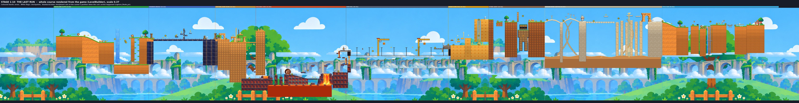

# Stage 1-10 — THE LAST RUN

The final stage: nine different lands joined into one continuous course, built
from the 49-cut final PV storyboard (`Melos_PV_Final_49_Storyboard.pdf`,
`Melos_PV_49_Shot_List.csv`). Everything in the storyboard that is an action is
a working mechanism in the game: the runner's real physics, the guardian's real
platform/wall/shot abilities, and machines and enemies that act on both.

The map above is rendered from the game itself (`tools/export_stage_maps.tscn`,
the production `LevelBuilder`) and annotated with areas, checkpoints and where
each PV cut was actually played (`tools/promotion/annotate_finale_map.py`).
Full size: [stage-1-10-map.jpg](images/stage-1-10/stage-1-10-map.jpg).

## Playing it

* Stage select shows a tenth card, **1-10 THE LAST RUN** (`StageCards`). The
  card art is a real render of the volcano (`tools/capture_stage_cards.tscn --
  --finale-only`).
* `Stage.Which.FINALE` is appended as **15**; every earlier handshake value is
  unchanged. `Protocol.VERSION` is 30 so mismatched builds refuse each other.
* 1-10 is **not** in `Stage.FREE_STAGES`: the purchase/unlock rules are
  untouched, so it is playable with the full game, a dev token, or as a guest
  of a buyer, and shows the existing lock for free players. Making it free is a
  one-line change plus the store-listing check in `tools/release-check.sh`.
* 13 checkpoints, a goal at x=28,600, death/respawn and restart all use the
  existing systems. A run takes roughly 4–6 minutes.

## The nine areas

| Area (PV seconds) | World x | What changes the terrain | Enemies |
| --- | --- | --- | --- |
| Grassland cliffs (0–10) | −900…3,000 | Curved downhill; a 710px chasm whose far bank stands 200px **higher** than the take-off lip — above the apex of a sprint double jump (measured: 301px), so the best jump falls short just below the ledge. The guardian's traced staircase is the rescue. A chimney of ledges behind the far bank lets a solo runner climb out of the 940px-deep chasm. A painted, animated waterfall falls behind the chasm. | Burrbug (1-3 sprout): walks up to meet the runner, skids and turns when jumped over |
| Thunder bridge (10–13) | 3,000…5,800 | 13 deck spans. Crossing trigger lines calls lightning: 0.75s of glowing spans, then the bolt — flash, shake, spans burst and fall. The second strike opens a 320px double gap: the route moves **up** onto broken spans, two electrified on a 3s cycle. Shooting the lightning rod earths them for 5s. | Spark wisps (recoloured 1-3 wisp) hover and lunge |
| Sand ruins (13–16) | 5,800…7,500 | Two-level hall with a sand waterfall that pushes you down; a 160×130 chained stone block swings through both levels (crouch under it at the bottom of its arc, 36px clearance); the last floor **collapses tile by tile** into a 1,500px shaft with falling stones. | 1-6 scarab and mummy, patrolling the upper tiers |
| Volcano core (16–20) | 7,500…11,300 | Basalt pillars over a lethal lake; a **magma sphere** freed behind the runner rolls down the cracked slope faster than a run, smashes the crust bridge (the low path is gone) and sinks. Escape ledge needs a double jump. The guardian's wall stops the sphere while it stands. Two chain swings; three **geyser lifts** thrown 300–340px up by eruptions between lethal lava jets. | Magma slime hopping pillar to pillar, fire bat |
| Iron rail (20–24) | 11,300…15,600 | Two trains on one 25s timetable (arrive from the west portal, stop 5s, pull away at 280px/s, vanish into the east tunnel). Roofs at mismatched heights; a 300–390px gap between the trains that breathes as they accelerate. Train momentum is kept through jumps. Line-side posts, wind streaks off the cars and loco smoke show the speed. Cranes drop crates onto passing cars (the second right in front of a runner who has just leapt to the lead train); landed crates ride the car as new obstacles/steps. A low bridge sweeps anyone still on a roof — leave by the footbridge. | Rail gunners (1-7 turret) ride the roofs and fire back down the train |
| Honeycomb hive (24–30) | 15,600…17,300 | Honey pools stall a landing and cut jumps to 60%; inverted wax tiers; a level-paddle honey wheel; a **honey bubble** that bends under you then flings you into a 1,000px shaft where a honey current carries you up to a **wax membrane** that bursts when hit from below. | Wax wisps that swarm after the runner, keeping apart |
| Stone giant (30–33) | 17,300…19,660 | Isolated tilted ledge; a giant automaton of ruin blocks **rises out of the gorge**, swats the standing slab that blocks the way so it **topples into a bridge**, then sweeps a chained spiked mace low across that bridge. Shooting its chest core staggers it (mace hangs still 2.5s). | — |
| Dragon bone canyon (33–39) | 19,660…24,600 | Arched fossil-rib bridges (polygon slopes), a vertebra bridge the **skeletal beast erupts through** (three vertebrae burst out), sand geysers that blow you up to the high rib path, **collapsing bone pillars** and a **jaw chase** at 350px/s that ends when the jaws slam shut on the stone gate. | Rotor-skull drones (7) drift, wind up and lunge |
| Title run (39–49) | 24,600…28,900 | Long meadow downhill (runner in the lower third, sky clear for the title), a rail saw, a spike pit, a cannon on the high step, a post saw beside checkpoint 12, narrow pillars over a spike bed (where the guardian's awkward blocks come in), a dipping saw, a lift, coin line, rope bridge and goal. | Brass drones shadow and dive; cannon; burrbug |

No area is a flat run to the right: every one changes height by hundreds of
pixels (the course spans y=−60…2,960) and most change direction (down a
shaft, up a geyser stack, up a hive shaft, chased from behind).

## Machines

All 1-10 machines are `FinaleMachine` subclasses in
`src/entities/gimmicks/finale/`, built from stage data by `LevelBuilder`
(`"finale_machine"` / `"finale_slope"` specs, validated by
`StageSpecSchema`). Shared rules:

* Poses are pure functions of `Clock.tick` and of the tick a state began, so
  both devices and rebuilt worlds agree.
* Only the host decides state changes (triggers, shots) and announces them as
  `"id|state|tick|aux"` through `Events.switch_activated`, which `HostSession`
  already relays and replays on every handshake (`replay_id()`).
* Forces on the runner are applied on the host only. Each machine has a
  collision/trigger, a readable telegraph, a counterplay, and a sound/FX hook
  (`Audio.play` keys + `FinaleFx` shake/flash).

| Machine | Acts on | Counterplay | Telegraph / FX |
| --- | --- | --- | --- |
| storm_bridge | deck spans (collision), runner (hit) | jump the gap; vault the high spans; shoot the rod | glowing spans, bolt, flash, shake, falling stones |
| pendulum_block | runner (heavy knockback) | crouch under / time it / take the high route | swing smear, whoosh at the bottom |
| sandfall | runner (pushed down) | go round it | scrolling sand |
| sand_collapse | floor tiles (collision) | — it is the way on | cracks, shake, sand pouring |
| rockfall | runner (damage) | wall-slide away from the glint | glint 0.5s before the drop |
| lava | runner (death) | don't fall | animated surface |
| magma_ball | runner (death), crust (collision) | sprint, escape ledge, guardian wall | tube glow, trail, shake, splash |
| chain_swing | carries the runner | board at the extreme | chains |
| geyser_lift (+ volcanic_hazard jets) | carries the runner up / kills | ride the slab; avoid jets | steam rumble 0.9s before |
| rail_line | carries the runner; crates; low bridge | board when parked; leap; footbridge | hook flash + shadow before a drop; flashing low-bridge lamp |
| honey | runner (speed/jump) | jump from outside the pool | honey on the boots |
| paddle_wheel | carries the runner | ride a paddle | — |
| honey_shaft | runner (launch, lift), membrane | land on the bubble | bubble squash, current, debris |
| stone_giant | slab (bridge), runner (mace) | wait for the bridge, jump the mace, shoot the core | rise, swat shake, swing smear |
| bone_beast | deck (collision), runner (death) | wait out the eruption, jump/geyser, keep running | eruption shake, snapping jaws |
| bone_pillar | collision | keep moving (0.35s) | shudder |
| sand_geyser | runner (lift) | ride it | rising dust 0.8s before |
| saw | runner (death) | time it | spin smear |

## Enemies

`FinaleEnemy` (`src/entities/enemies/finale_enemy.gd`) — eight behaviours,
none of them a reskinned patrol and none modelled on Mario characters:
burrbug, spark, magma_slime, fire_bat, rail_gunner, wax_wisp, skull_drone,
brass_drone. All take the guardian's shot; contact costs a heart. The sand
ruins also use the existing 1-6 desert cast, and the title run the existing
turret.

## Two-player play

The guardian (second player, no avatar) uses the existing tools only:
platforms (tap or a drawn stroke), the wall, the shot. The course is built
around them: the opening chasm cannot be crossed without platforms (or the
slow solo chimney), the lightning rod and the giant's core are shot targets,
the wall stops the magma sphere, and enemies are the guardian's to clear.
Awkward placements (the PV's comedy cuts) are ordinary platforms drawn in odd
places over the title run's spike bed; the runner has to cope with them.

## Art

Colour and tone follow 1-1. Most art is the existing painted sets reused:
1-1 meadow panorama, terrain and props; 1-3 waterfalls, aqueduct, sprouts,
planks; 1-5 lava platforms, lavafalls, slime, bat; 1-6 desert board, stones,
arches, columns, palms; 1-7 chain, lamp, gear, pendulum ball, turret; 1-8
boulder; keeper core.

New raster art (`assets/stage_1_10/`, 22 PNGs, 4.4MB) is made by
`tools/make_finale_assets.py` — procedurally painted at 4× and downsampled
with the split assets' outline/lighting, or colour-graded composites of the
earlier paintings: storm backdrop (graded 1-6 board + clouds), canyon backdrop
and fossil-rib layer, honeycomb backdrop, wax and bone textures, honey cap,
sand stream, magma sphere, skull and brass drones, honey bubble, saw blade,
four train cars, crane, spark and wax wisps (recoloured 1-3 wisps). These are
programmatic paintings, not hand-painted illustrations; they read correctly
in game (see the stills) but are the first place to spend an artist's time.
Lightning bolts, rain, honey drips, chains and particles are drawn at runtime.

## PV shooting data

The PV is played and recorded by a director script in the real stage. See
[promotion/stage-1-10/pv-rebuild.md](promotion/stage-1-10/pv-rebuild.md) for
the audit of the first render and what changed, and
[promotion/stage-1-10/pv_match.md](promotion/stage-1-10/pv_match.md) for the
per-cut storyboard match table.

* `src/levels/finale_shots.gd` — the 49 cuts: names, seconds, areas and the
  storyboard's camera/action text.
* `tools/promotion/capture_finale_pv.tscn` — the director. A play script per
  area drives the runner through `InputHub.drive_runner` and the guardian
  through `Guardian.use_active` (traced `place_path` platforms included),
  deciding from game state (machine phases on the shared `Clock`, positions,
  floor contact). Every cut is exactly 60 on-air frames; each has its own
  camera (follow / fixed pan / fit-several-targets, zoom ease, tilt, shake,
  hit-stop) and is checked for *intent*, *happened* and *visible*. Slow
  motion (cuts 4–7) is the real simulation at `Engine.time_scale`.
* `tools/promotion/pv_overlay.gd` — the in-game screen layers: the incoming
  call (official Discord mark, decline/accept buttons, no text), the blue YOU
  hand pointer, the MELOS GAME title drawn between the backdrop and the world,
  and the end cards (official Google Play / App Store badges, COMING OCTOBER
  2026, Created by Takumi & TyoRo) one at a time on a lower panel. Assets in
  `assets/promo/` (sources in `assets/promo/SOURCES.md`).
* `tools/promotion/render_finale_pv.py` — locates the slate, cuts the 49 × 60
  frames with their game sound, lays the project's synthesized stage music
  under it, checks every logged sound against the audio, and writes the
  contact sheet and storyboard comparison sheets.
* `tools/promotion/export_finale_shots.py` — copies the report and writes
  `docs/promotion/stage-1-10/shots.csv` and `pv_match.md`.

Run (needs a display; Xvfb works):

    xvfb-run -a -s "-screen 0 1280x720x24" godot --path . \
        --rendering-method gl_compatibility --rendering-driver opengl3 \
        --fixed-fps 60 --resolution 1280x720 \
        --write-movie build/promotion/stage-1-10/pv/takes.avi \
        res://tools/promotion/capture_finale_pv.tscn -- [--take=opening,storm,...]
    python3 tools/promotion/render_finale_pv.py [--storyboard DIR]

Headless (`--headless --fixed-fps 60`, no movie) runs the same play and
checks in about 15 seconds. `.github/workflows/finale-pv.yml` does both on CI
and uploads the MP4, report, audio check and contact sheet.

## Tests

* `test/finale_stage_probe.tscn` (gated in `tools/verify.sh`): registration,
  schema, network ranges, checkpoints on ground; a scripted playthrough of
  every area with the real runner/guardian and live machines from start to
  goal; the solo chimney climb; each mechanism's failure case (pendulum hit,
  electrified spans, magma sphere kill and wall hold, low bridge, crate drop,
  sand jet, jaws, mace, honey jump cut); all eight enemy kinds act and die to
  shots; death → checkpoint respawn with the area rebuilt; restart. 152 checks.
* `tools/perf_probe.tscn -- --stage 1-10 --budget` walks the course through
  every checkpoint: 137–142 peak draw calls, ~3,170 objects (budget 160 /
  3,500 in `tools/perf_budgets.cfg`).

## Known limits

* Online two-device play of 1-10 is designed for (host-authoritative,
  replayed states) but not tested with two devices. A rejoining guest gets
  each machine's main state; the lightning rod's and the giant's short-lived
  stagger state are not replayed.
* The rail's momentum carry and the honey/geyser forces act directly on the
  runner on the host; they are not part of the runner's own movement model.
* Difficulty and pacing have only been played by the scripted bot.
* On 1-10 the guardian's platforms are drawn as blue glowing blocks (as in
  the storyboard); other stages keep the painted yellow slab. Collision and
  timing are the same.
* The Discord call, title and end cards are drawn by the PV director, not by
  the game's own HUD.
